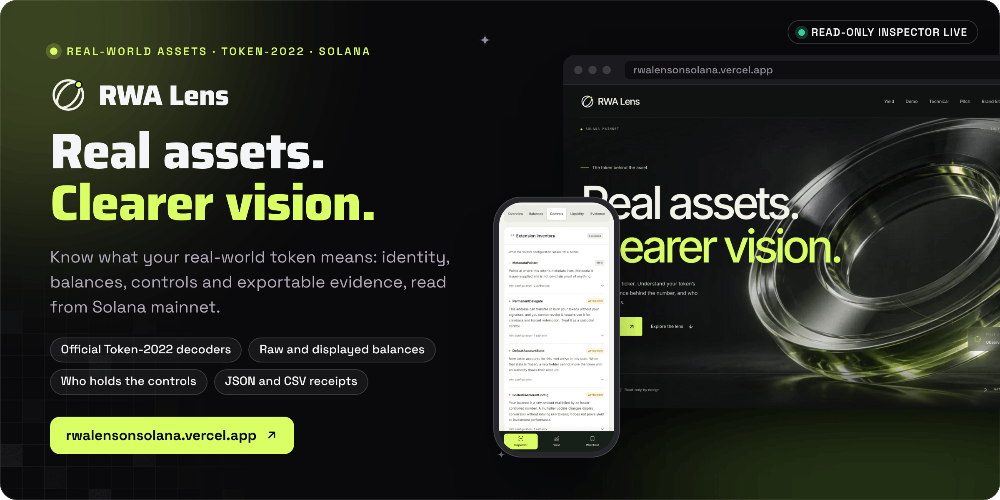
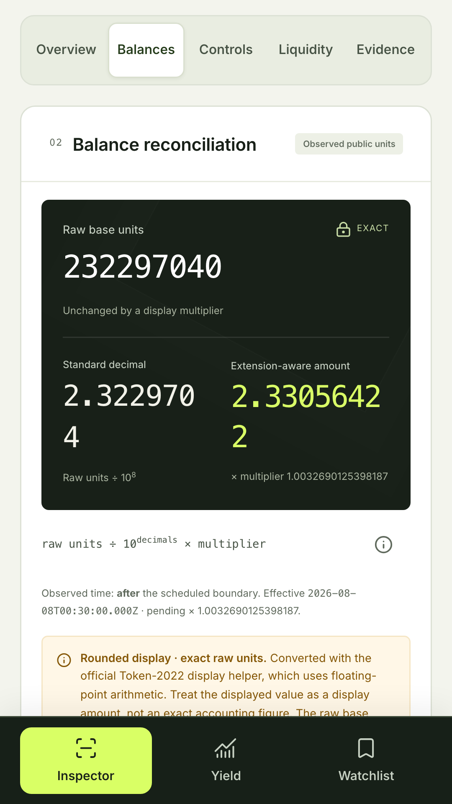
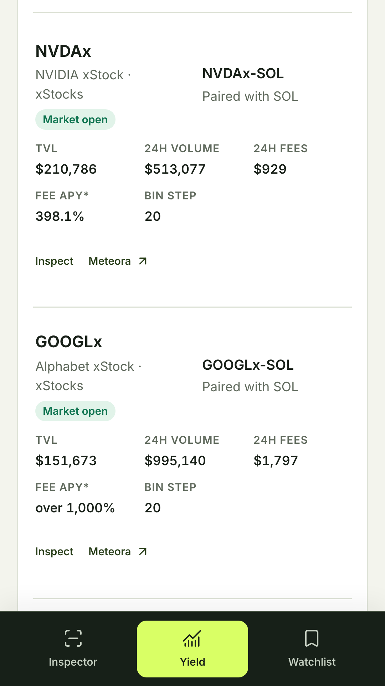
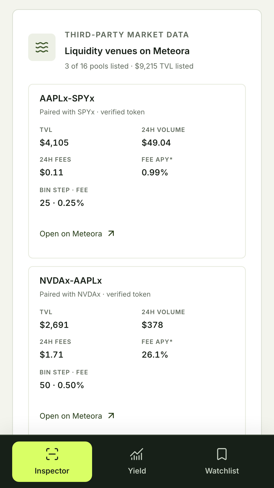
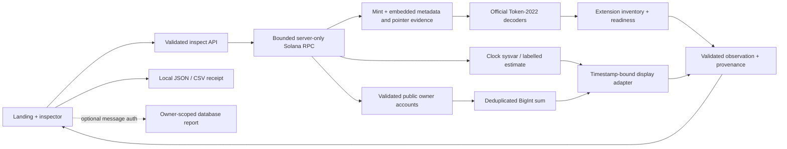

<div align="center">



<br><br>

<a href="https://rwalensonsolana.vercel.app/rwa"></a>&nbsp;&nbsp;
<a href="https://rwalensonsolana.vercel.app/yield"></a>&nbsp;&nbsp;
<a href="https://rwalensonsolana.vercel.app/demo"></a>

<br><br>

<a href="https://github.com/operatoruplift/rwa-lens/actions/workflows/ci.yml"></a>
<a href="https://rwalensonsolana.vercel.app"></a>


<a href="LICENSE"></a>

<h3>Understand your token's identity, the balance behind the number, and who holds the controls.</h3>

<b>Paste a mint</b> &nbsp;→&nbsp; <b>Read</b> &nbsp;→&nbsp; <b>Decode</b> &nbsp;→&nbsp; <b>Reconcile</b> &nbsp;→&nbsp; <b>Explain</b> &nbsp;→&nbsp; <b>Export</b>

<br>

<a href="#how-it-works">How it works</a> &nbsp;·&nbsp;
<a href="#markets-around-the-token">Markets</a> &nbsp;·&nbsp;
<a href="#status">Status</a> &nbsp;·&nbsp;
<a href="#run-it-locally">Run it locally</a> &nbsp;·&nbsp;
<a href="#documentation">Docs</a>

</div>

<br>

<picture>
  <source media="(prefers-color-scheme: dark)" srcset="docs/readme/screens-dark.png">
  
</picture>

<p align="center"><sub>Captured from a local production build on 30 October 2026, replaying the repository's archived mainnet observations of 19 September 2026 (<a href="docs/evidence/live-observations.json">USDY</a> and <a href="docs/evidence/token-2022-live-observation.json">Apple xStock</a>) the way its browser tests do. No new chain read was made.</sub></p>

**RWA Lens is a read-only inspector for tokenized real-world assets on Solana.** It reads SPL Token and Token-2022 mints with the official decoders, reconciles raw and displayed balances (Scaled UI Amount, fees, frozen state) and lists who can transfer, freeze or burn. It is for wallet builders, issuers, fund administrators, custodians and treasury operators who need the observable facts behind a token, and the evidence to show for them. Inspection never signs or submits a transaction, moves assets, mints, settles, lends or takes custody.

Built by Matt ([RVAClassic](https://x.com/rvaclassic), [Operator Uplift](https://operatoruplift.com)) for the Solana Foundation **Tokenized Real-World Assets** sprint, September 2026.

<br>

## How it works

<picture>
  <source media="(prefers-color-scheme: dark)" srcset="docs/readme/flow-dark.png">
  
</picture>

<table>
  <tr valign="top">
    <td width="33%"><b>Raw units stay exact</b><br><sub>Raw amounts and supply stay decimal strings and <code>BigInt</code>. Public accounts are validated for program, mint and owner and deduplicated before summing. The official Scaled UI Amount conversion is an isolated display calculation, labelled <code>official-helper</code>, and never feeds back into raw accounting.</sub></td>
    <td width="33%"><b>Controls in plain words</b><br><sub>Every extension is decoded and explained for a holder, from a permanent delegate to a transfer hook. Readiness keeps known blocks and unknown checks visible side by side; it explains inspected data and is not a transaction simulation or legal authorization.</sub></td>
    <td width="33%"><b>Evidence, not claims</b><br><sub>The mint, Clock and owner reads each expose their own context slot, and separate reads are never presented as an atomic snapshot. Issuer descriptions are attribution, not verification of backing or legal rights.</sub></td>
  </tr>
</table>

The curated asset is **Ondo USDY**, an officially attributed non-stock Treasury-linked note on Solana. The checked-in [source manifest](lib/rwa/live-assets.json) records the exact mint, network, issuer sources and retrieval date. USDY's observed mint uses **legacy SPL Token**; neither program ownership nor metadata proves an asset is an RWA. Production opens a live mainnet inspection and rejects offline fixture requests, while scheduled Token-2022 display multipliers are covered by deterministic tests and an explicitly enabled devnet test mode.

<details>
<summary><b>Token-2022 extensions it explains</b></summary>
<br>

The active multiplier is selected using the observed Clock sysvar timestamp. Block time or local-clock fallback is explicitly an estimate, and incomplete accounts and unsupported data remain partial or unknown.

| Extension | Explanation |
|---|---|
| Scaled UI Amount | Changes display conversion without changing raw units; scheduled boundaries and rounding are shown. |
| Interest Bearing | Decoded and reported: current rate, pre-update rate and the rate authority, shown next to the exact standard decimal amount. Accrued display value sits outside this release's conversion scope, and Token-2022 treats the extension as incompatible with Scaled UI Amount. |
| Transfer Hook | Names the hook program and its update authority, and keeps transfer success an open question rather than executing that program. When the extension carries no hook program, it says so plainly: no extra program runs on transfer today, and it names the authority able to set one later. A hook address is not a KYC credential. |
| Default Account State | Describes newly created accounts; existing account states are checked separately. |
| Permanent Delegate | Discloses the mint-level authority that holders cannot revoke. |
| Transfer Fee Config / Amount | Shows fee configuration and withheld units separately; holding alone does not charge a fresh fee. |
| Pausable / Non-transferable | Shows observed blocking state and applicable authority. |
| CPI Guard | Explains CPI-specific restrictions without declaring every owner transfer blocked. |
| Metadata / group pointers | Shows decoded pointers and safely bounded retrieval evidence. |
| Confidential / unknown variants | Distinguishes observable public units from unobservable data; never invents an encrypted balance. |

</details>

<p align="center"><sub>Next.js 16 · React 19 · TypeScript · @solana/kit 8 · @solana-program/token-2022 · Zod · Supabase (optional) · Tailwind CSS 4 · Vitest · PGlite · Playwright · PWA · Android Web Shell</sub></p>

<br>

## Markets around the token

Market data sits beside an inspection, never inside it: these figures are third-party, they are not part of an observation, its JSON or CSV export or a saved report, and past fees do not predict returns.

<table>
  <tr>
    <th width="20%" align="left">Feature</th>
    <th width="48%" align="left">What it shows</th>
    <th width="32%" align="left">Boundary</th>
  </tr>
  <tr valign="top">
    <td><b>Liquidity venues</b></td>
    <td>After a live mainnet inspection, the Meteora DLMM pools that hold the exact mint: pair, TVL, 24-hour volume and fees, fee APY, bin step and base fee, with a link to each pool.</td>
    <td>At most five pools with at least $100 TVL, each mint cached for 60 seconds.</td>
  </tr>
  <tr valign="top">
    <td><b>Reserve badge</b></td>
    <td>Whether the attribution source links the issuer's own reserve reports. For USDY it links Ondo's USDY page, which publishes daily and monthly third-party reserve attestations.</td>
    <td>RWA Lens links those reports; it does not read, audit or verify them.</td>
  </tr>
  <tr valign="top">
    <td><b>Yield screener</b></td>
    <td><a href="https://rwalensonsolana.vercel.app/yield"><code>/yield</code></a> lists Meteora DLMM pools with at least $100 TVL that hold Ondo USDY or any xStock with a Solana deployment (about 1,000 tokens checked), with filters in the URL and a link into the inspector for each token.</td>
    <td>A snapshot stays fresh for 10 minutes and can be served with a stale label for up to an hour.</td>
  </tr>
  <tr valign="top">
    <td><b>Deploy USDC</b></td>
    <td>Only with <code>RWA_DEPLOY_ENABLED=true</code>: a Jupiter swap of half the budget plus a Meteora DLMM Spot deposit across 69 bins, built and simulated as one v0 transaction whose only signer is your wallet.</td>
    <td>Off on the public deployment. The server never signs, holds keys or takes custody.</td>
  </tr>
</table>

<table>
  <tr valign="top">
    <td width="33%" align="center"><br><sub><b>Balances</b>: raw units, standard decimal and the extension-aware amount</sub></td>
    <td width="33%" align="center"><br><sub><b>Yield</b>: pools that hold tokenized assets, with the issuer's market session</sub></td>
    <td width="33%" align="center"><br><sub><b>Liquidity</b>: the token's Meteora pools, labelled third-party data</sub></td>
  </tr>
</table>

<p align="center"><sub>From the repository's dApp Store listing kit in <a href="docs/dapp-store/listing.md">docs/dapp-store</a>, which <code>scripts/capture-store-assets.mjs</code> captures from the live canonical site with the mainnet data of its capture day.</sub></p>

<details>
<summary><b>How the market data is read and bounded</b></summary>
<br>

**Venues.** The server reads Meteora's public data API (`dlmm.datapi.meteora.ag`) through the same DNS-pinned, redirect-free, size-bounded HTTPS reader used for issuer metadata, keeps only pools whose own token list contains the mint (the upstream search also matches names), drops blacklisted pools, lists at most five with at least $100 TVL, and caches each mint for 60 seconds. A token without a recorded reserve link says so plainly.

**Yield screener.** Rows show TVL, 24-hour volume and fees, Meteora's fee APY, bin step and the issuer's reported market session. Filters for issuer, pair and minimum liquidity live in the URL, so a view can be shared, and each row links to the inspector (`/rwa?mint=<address>`) and to the pool on Meteora. The server refreshes the xStocks public catalog and Meteora's filtered pool search together. Pool queries are paginated with bounded, DNS-pinned requests; if completeness cannot be established within the limits, the refresh fails rather than silently dropping pools. The inspector's five-pool display limit does not apply to the screener. Issuer identities can survive a temporary catalog outage, but market session flags become unknown after ten minutes. Responses bypass browser and CDN caching so those flags cannot acquire a new apparent age. One-day fee annualisations above 1,000% are shown as "over 1,000%".

**Deploy USDC.** The server refuses unsafe cases (hooked or fee-charging mints, stale pool prices, oversized price impact, and any Jupiter step beyond its direct swap and creating the wallet's own token accounts), refuses a route that would write to any other token account the wallet holds, and simulates the whole transaction against mainnet, checking the simulated balances against the preview, before the wallet sees it. The DLMM instructions are hand-encoded and pinned byte for byte to Meteora's official SDK; live mainnet simulations succeeded for USDY (SPL Token) and METAx, TSLAx and QQQx (Token-2022). Details, checks and evidence: [docs/yield-deploy.md](docs/yield-deploy.md).

</details>

<br>

## Status

<table>
  <tr valign="top">
    <td width="16%" align="center"></td>
    <td>Mainnet inspection and guest JSON and CSV export on the <a href="https://rwalensonsolana.vercel.app/rwa">inspector</a>, plus the <a href="https://rwalensonsolana.vercel.app/yield">yield screener</a>, <a href="https://rwalensonsolana.vercel.app/watchlist">watchlist</a>, <a href="https://rwalensonsolana.vercel.app/demo">guided demo</a>, <a href="https://rwalensonsolana.vercel.app/technical">technical breakdown</a>, <a href="https://rwalensonsolana.vercel.app/pitch">pitch kit</a> and <a href="https://rwalensonsolana.vercel.app/brand-kit">brand kit</a> at <a href="https://rwalensonsolana.vercel.app">rwalensonsolana.vercel.app</a>. The latest recorded hosted audit, on 30 September 2026, passed sixty primary browser checks across seven routes, and production rejected offline fixture requests.</td>
    <td width="22%"><a href="docs/rwa-release-2026-09-30.md">30 September release</a></td>
  </tr>
  <tr valign="top">
    <td align="center"></td>
    <td>Cloud reports with wallet message sign-in and Delete my data, and the wallet-signed Deploy USDC action. Both are implemented and covered by mocked browser suites; the public deployment keeps them off, and automated wallet tests do not establish a funded on-chain deposit.</td>
    <td><a href="docs/yield-deploy.md">Deploy USDC</a></td>
  </tr>
  <tr valign="top">
    <td align="center"></td>
    <td>The installable PWA and the Seeker Android Web Shell source (<code>com.operatoruplift.rwalens</code>, wrapping <code>/rwa</code>), plus the dApp Store listing kit. A signed release APK, on-device wallet validation and a store submission remain separate steps; no store publication is claimed.</td>
    <td><a href="docs/seeker-and-pwa.md">Seeker and PWA</a></td>
  </tr>
  <tr valign="top">
    <td align="center"></td>
    <td>Built for the Solana Foundation Tokenized Real-World Assets sprint, September 2026. The two-minute demo script states that no hackathon submission is made by its release.</td>
    <td><a href="docs/rwa-demo-script.md">Demo script</a></td>
  </tr>
</table>

No backing, compliance, eligibility, redemption, investment-performance or transfer-success certification is made, and nothing here claims traction or audits that have not happened. See the [limitations](docs/rwa-limitations.md).

<br>

## Run it locally

<table>
  <tr valign="top">
    <td width="33%"><b>Prerequisites</b><br><sub>Node 22.19 or newer and the checked-in npm lockfile (Next.js 16.4.3). A Solana mainnet RPC endpoint for live reads; the public one rate-limits.</sub></td>
    <td width="33%"><b>Read first</b><br><sub>The <a href="docs/rwa-limitations.md">limitations</a>, and <a href="docs/rwa-deployment.md">deployment and rollback</a> before touching production settings.</sub></td>
    <td width="33%"><b>What the checks prove</b><br><sub>The <a href="docs/rwa-demo-evidence.md">verification evidence</a> holds the measured results. Historical counts there are dated receipts, not current verification.</sub></td>
  </tr>
</table>

### 1. Run the app

```bash
npm ci
cp .env.example .env.local         # then set RWA_RPC_URL, as below
npm run dev                        # http://127.0.0.1:3000, and /rwa is the inspector deep link
```

The app defaults to mainnet with fixtures disabled. Configure an operator-managed RPC endpoint in `.env.local`:

```dotenv
RWA_CLUSTER=mainnet-beta
RWA_RPC_URL=https://api.mainnet-beta.solana.com
```

The public RPC can rate-limit; use an operator-managed provider for sustained traffic. A browser cannot supply an RPC URL, only the operator's configured network is supported, and no silent network fallback occurs. For isolated development only, `RWA_CLUSTER=devnet` together with `RWA_FIXTURES_ENABLED=true` exposes the clearly marked offline test scenarios.

### 2. Before a pull request, run what [CI](.github/workflows/ci.yml) runs

```bash
npm run lint
npm run typecheck
npm test                           # unit, route and migration tests (migrations run on PGlite)
npm run build                      # run this first: the browser suites start the production build
npx playwright install chromium
npm run test:e2e                   # next start on port 3300 with mocked mainnet responses, no secrets
npm run test:e2e:deploy            # port 3301, mocked wallet and transactions; never signs or sends funds
npm run test:e2e:reports           # port 3302, saved reports on with placeholder storage, every API mocked
```

The reports suite covers sign-in from My reports and Delete my data. Landing checks cover desktop and mobile scrolling, anchor focus, dynamic reduced motion, and marketing content plus fragment links that stay usable with JavaScript turned off. Give each build sole ownership of one `.next` directory.

### 3. Verify a hosted deployment, read-only

```bash
node scripts/verify-live.mjs
# Optional local production target:
RWA_VERIFY_BASE_URL=http://127.0.0.1:3300 node scripts/verify-live.mjs
```

This reads the official non-stock mint and a declared public owner, checks that production rejects offline test data, and writes `docs/evidence/live-observations.json`. It sends no transaction. GitHub's `Verify RWA Lens` workflow runs the deterministic checks on pushes and pull requests; `Explicit hosted read verification` is invoked by hand and uses no wallet or provider credentials.

### Configuration

Every variable is documented in [.env.example](.env.example). RPC URLs, session secrets and database service-role keys stay server-only, and metadata hosts are deny-by-default.

| Variable | Purpose |
|---|---|
| `RWA_CLUSTER` | `devnet` or `mainnet-beta`. Browser requests must match it and can never select an RPC URL. |
| `RWA_RPC_URL` | Required for live reads; missing configuration produces an explicit unavailable state. A dedicated provider is strongly preferred. |
| `RWA_RPC_TIMEOUT_MS`, `RWA_RPC_MAX_ACCOUNTS`, `RWA_INSPECT_CACHE_SECONDS` | RPC deadline (8000 ms), owner-account cap (100) and inspection cache (15 seconds) in the template. |
| `RWA_UPSTREAM_RPC_PER_MINUTE`, `RWA_UPSTREAM_METEORA_PER_MINUTE` | Deployment-wide ceilings counted in the shared rate-limit table (defaults 300 and 120, accepted 1 to 1000). |
| `RWA_FIXTURES_ENABLED` | Offline fixtures, only with `RWA_CLUSTER=devnet` and never on Vercel production. |
| `RWA_REGISTRY_URL`, `RWA_REGISTRY_ALLOWED_HOSTS` | Optional issuer registry, disabled unless configured. Optional adapters cannot supply invented fiat values. |
| `RWA_METADATA_ALLOWED_HOSTS` | HTTPS hosts a token metadata URI may be fetched from. Empty means no metadata URI is ever fetched. |
| `NEXT_PUBLIC_SUPPORT_EMAIL` | Contact on `/privacy` and `/terms` (build time); unset falls back to this repository's issues. |
| `RWA_REPORTS_ENABLED`, `RWA_SESSION_SECRET`, `RWA_APP_ORIGIN`, `RWA_SUPABASE_URL`, `RWA_SUPABASE_SERVICE_ROLE_KEY` | Optional wallet sign-in and private reports, required together, on a dedicated RWA database only. Apply every file in `supabase/migrations` in name order first. |
| `NEXT_PUBLIC_SUPABASE_URL`, `NEXT_PUBLIC_SUPABASE_PUBLISHABLE_KEY`, `RATE_LIMIT_SECRET` | The legacy shared read limiter in the independent RWA database. Unset `RATE_LIMIT_SECRET` means a per-instance window. |
| `SUPABASE_SECRET_KEY` | Legacy name kept for documentation; unused by the reports repository. |
| `RWA_DEPLOY_ENABLED`, `JUPITER_API_KEY`, `RWA_DEPLOY_PRIORITY_MICROLAMPORTS` | The optional Deploy USDC action, mainnet only. A Jupiter key is recommended in production; the compute-unit price defaults to 100000 micro-lamports (maximum 5000000). |

<details>
<summary><b>API</b></summary>
<br>

| Endpoint | Behavior |
|---|---|
| `POST /api/rwa/inspect` | Validated live request or fixed fixture ID and scenario; same response contract. |
| `POST /api/rwa/metadata` | Explicit request, configured HTTPS allowlist, DNS and private-IP rejection, pinned connection, timeout and size caps. |
| `POST /api/rwa/auth` | Optional exact-origin wallet message authentication and sign-out; durable single-use challenge required. |
| `GET/POST /api/rwa/reports` | Optional session-owned reports; the server re-inspects instead of trusting uploaded observations. |
| `GET /api/rwa/reports/[reportId]` | Session-owner lookup; another owner's opaque ID returns 404. |
| `DELETE /api/rwa/account` | Delete my data: exact-origin, rate-limited; deletes the session wallet's reports and pending sign-in challenges, then clears the session. |
| `GET /api/rwa/venues` | Meteora DLMM pools holding the exact mint; third-party market data, never part of an observation. |
| `GET /api/rwa/screener` | Server-cached snapshot of pools holding known tokenized assets (xStocks catalog, Ondo attribution); no parameters, HTTP no-store. |
| `POST /api/rwa/deploy` | Only with `RWA_DEPLOY_ENABLED`: same-origin, rate-limited; returns an unsigned, simulated v0 transaction for the caller's wallet, or a plain refusal. |
| `GET /api/rwa/deploy/status` | Only with `RWA_DEPLOY_ENABLED`: confirmation for a submitted signature and its last valid block height. |

```json
{"mode":"live","cluster":"mainnet-beta","mint":"A1KLoBrKBde8Ty9qtNQUtq3C2ortoC3u7twggz7sEto6"}
```

Development fixture requests cannot override balances, identity, timestamps or provenance, and production rejects them with 403. Malformed input returns 400, missing accounts 404 and a non-mint account 422. A provider failure is reported honestly as a structured `unavailable` state with the matching 5xx status, so a caller can always tell a failed read from an empty one. Error bodies contain neither credentials nor stack traces.

</details>

<details>
<summary><b>Architecture</b></summary>
<br>



</details>

<details>
<summary><b>Optional reports and security boundaries</b></summary>
<br>

Production inspection and export are guest features that need no account. Cloud reports and wallet sign-in are deployment-configured capabilities: supply the complete independent database, origin, secret and durable challenge configuration and the owner-scoped report path is served, while the app stays fully usable as a guest with local JSON and CSV export either way. Optional wallet **message** signing authenticates saved-report ownership only, and saving a report is a database write. An HMAC cookie is not a Supabase JWT: service-role repository access relies on server-enforced ownership checked on every query and covered by tests, rather than automatic RLS identity mapping.

The existing **rwa-lens** Supabase project is independent of Lotline, and its shared rate limiter is preserved. Public reads keep a bounded per-instance local fallback, scoped deliberately to availability rather than to cross-instance protection. Authentication and report writes fail closed: when the shared limiter or the durable challenge store cannot be reached, no session is issued and nothing is written.

</details>

<details>
<summary><b>Visual identity and the brand kit</b></summary>
<br>

The home page pairs original optical artwork with gentle scroll depth, section reveals and a sticky optical illustration. Wheel, touch, keyboard and fragment navigation keep native browser scrolling, and `/rwa` opens a compact version for direct inspection; both routes keep the same public inspector. Motion follows the system's reduced-motion setting, marketing content remains readable without JavaScript, and the inspector stays outside the animated reveals.

The [brand kit](https://rwalensonsolana.vercel.app/brand-kit) includes an optical mark, wordmarks, profile images, three campaign posts, portrait and story layouts, headers, link previews and desktop and mobile wallpapers. Each composition is available as an editable SVG; campaign images also ship as PNGs, and the gallery uses smaller WebP previews. Download the complete ZIP or individual assets.

To rebuild it: after `npm ci`, install the renderer with `npx playwright install chromium`. The generator requires `/usr/bin/zip` on macOS and Linux, and `PW_EXE` can point to an existing Chromium executable. Run `node scripts/build-brand-kit.mjs` to rebuild the exports and the ZIP from the checked-in artwork and embedded Inter font. See the [brand guide](public/brand-kit/brand-guide.md) for dimensions, crop guidance and source resolution, and [attribution](docs/third-party-notices.md) for the MotionSites design references and the original artwork provenance.

</details>

<details>
<summary><b>Seeker, Android and PWA</b></summary>
<br>

RWA Lens installs as a PWA and ships an Android WebView shell (`android/`) for the Solana Seeker and dApp Store, with Solana Mobile Wallet Adapter support where the app connects a wallet. Offline, navigation shows a notice with a link back to the inspector; live inspection needs a connection, and an old observation is never substituted for a fresh read. Build, signing, test and publishing steps are in [docs/seeker-and-pwa.md](docs/seeker-and-pwa.md), and every Publisher Portal field is in the [listing kit](docs/dapp-store/listing.md).

</details>

<details>
<summary><b>Repository layout</b></summary>
<br>

| Path | Contents |
|---|---|
| `app/` | Landing, inspector (`/rwa`), yield, watchlist, demo, technical, pitch, brand kit, privacy and terms, and the `api/rwa/` routes |
| `components/` | Landing experience, workspace shell, inspector panels, deploy flow and resource pages |
| `lib/rwa/` | Schemas, balance and extension logic, readiness, venues, screener, deploy builders, fixtures and the USDY source manifest |
| `lib/server/rwa/` | Server-only RPC, inspection, metadata fetching, registry, venues, screener, deploy, rate limits, sessions, reports repository and configuration |
| `supabase/migrations/` | Reports, rate limiter, durable sign-in, Delete my data and rate-limit privacy migrations |
| `tests/` | Vitest suites (`tests/rwa`), opt-in live tests, and the three Playwright suites |
| `public/` | Brand and brand kit, demo films and captions, presentation kit, icons and the service worker |
| `android/` | The Seeker Web Shell project |
| `scripts/` | Brand kit, presentation kit, demo film capture and render, store assets and hosted-read verification |
| `docs/` | Evidence, capability matrix, limitations, deployment, release records, demo production and the listing kit |

</details>

<br>

## Documentation

<table>
  <tr valign="top">
    <td width="33%"><b>Understand it</b><br><sub><a href="docs/rwa-capability-matrix.md">Capability matrix</a><br><a href="docs/rwa-limitations.md">Limitations and boundaries</a><br><a href="docs/yield-deploy.md">Optional Deploy USDC</a><br><a href="https://rwalensonsolana.vercel.app/technical">How observations work</a></sub></td>
    <td width="33%"><b>Check it</b><br><sub><a href="docs/rwa-demo-evidence.md">Verification evidence</a><br><a href="docs/rwa-release-2026-09-30.md">Release verification, 30 September 2026</a><br><a href="docs/rwa-deployment.md">Deployment and rollback</a><br><a href="docs/evidence/">Machine-readable receipts</a></sub></td>
    <td width="33%"><b>Present it</b><br><sub><a href="docs/rwa-demo-script.md">Two-minute demo script</a><br><a href="public/presentation/rwa-lens-demo-guide.md">Presenter walkthrough</a><br><a href="public/presentation/rwa-lens-technical-breakdown.md">Technical breakdown</a><br><a href="https://rwalensonsolana.vercel.app/pitch">Pitch deck</a></sub></td>
  </tr>
  <tr valign="top">
    <td><b>Ship it</b><br><sub><a href="docs/seeker-and-pwa.md">Seeker, Android and PWA</a><br><a href="docs/dapp-store/listing.md">dApp Store listing kit</a></sub></td>
    <td><b>Brand it</b><br><sub><a href="public/brand-kit/brand-guide.md">Brand guide</a><br><a href="https://rwalensonsolana.vercel.app/brand-kit">Downloadable brand kit</a><br><a href="docs/optical-redesign.md">Optical redesign</a></sub></td>
    <td><b>Credit it</b><br><sub><a href="docs/third-party-notices.md">Third-party notices and design references</a></sub></td>
  </tr>
</table>

<br>

<p align="center"><sub>RWA Lens is MIT licensed (see <a href="LICENSE">LICENSE</a>); dependencies, fonts and the design references keep their own licenses, listed in the <a href="docs/third-party-notices.md">third-party notices</a>. RWA Lens reads public Solana token state; it does not establish legal compliance, asset backing, investment performance or issuer trust.</sub></p>

<p align="center"><sub>Built by <a href="https://rvaclassic.xyz">Matt Sim</a>, founder of <a href="https://operatoruplift.com">Operator Uplift</a>. More builds at <a href="https://github.com/operatoruplift">github.com/operatoruplift</a>. Want one built for your product? <a href="https://cal.com/rvaclassic/15min">Book a 15-minute call</a>.</sub></p>
